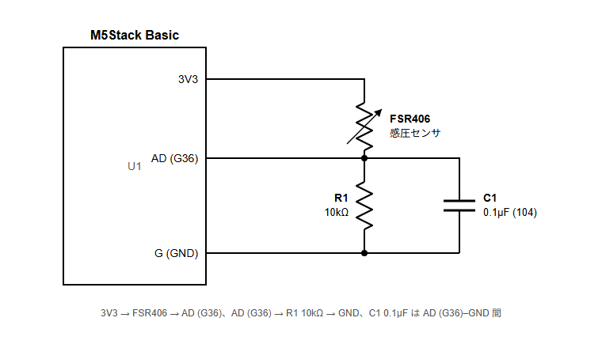
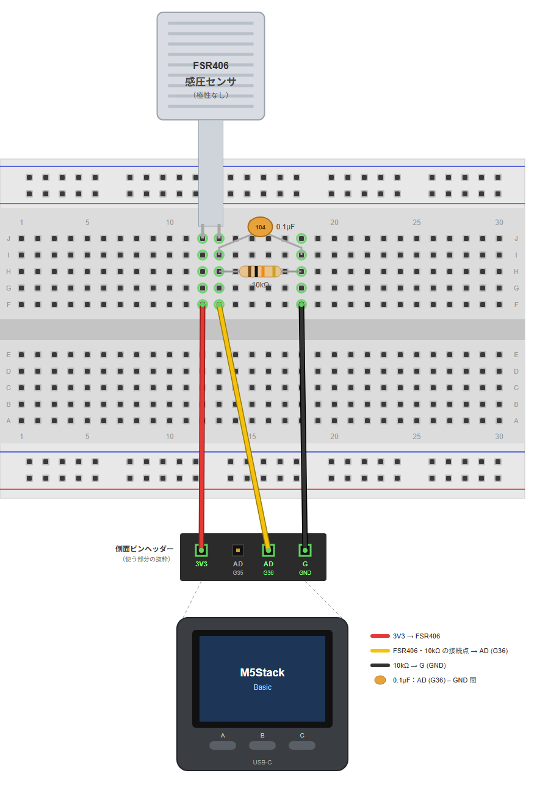
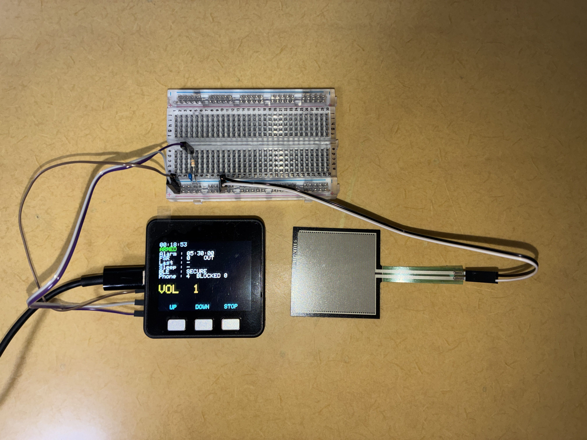

# OKI:LOCK

**スマホへの欲求を、起床する力に。**

チーム二度寝界隈

**OKI:LOCK プロモーション動画**

**📢 プロモーション動画更新のお知らせ（10月27日 10:30）**

OKI:LOCKの機能や動作をより分かりやすくお伝えするため、紹介動画を更新しました。

すでにご覧いただいた方も、よろしければ新しい動画をご確認いただけますと幸いです。

※Hack Day期間中に実装した機能の紹介内容を整理したものであり、審査開始後に新たな機能を追加したものではありません。

---

## 📑 目次

1. [製品概要](#overview)
2. [背景・解決したい課題](#background)
3. [想定ユーザー](#target-users)
4. [ユーザー調査・アンケート結果](#survey)
5. [課題の絞り込み](#problem-scope)
6. [既存手法との比較・独自性](#comparison)
7. [OKI:LOCKの主な機能](#features)
8. [デモ・動作確認](#demo)
9. [開発で注力したこと](#development)
10. [ハードウェア構成](#hardware)
11. [セキュリティ設計](#security)
12. [今後の展望・実用化に向けた課題](#future)
13. [開発技術・ソースコード](#technologies)

---

## 1. 製品概要

**スマホへの欲求を、起床する力に。**

OKI:LOCKは、**目覚めた後もスマートフォンを使い続け、なかなかベッドから出られない人のための起床支援システム**です。

ベッドに設置した圧力センサで在床・離床を検知し、M5StackによるアラームとAndroidアプリの利用制限を連動させます。

スマートフォンの対象アプリを使うためには、実際にベッドから出る必要があります。

**スマホを使いたいという欲求を、ベッドから出る動機に変える。**

私たちは、目を覚ますことだけでなく、**「予定していた時間にベッドから出る」という最初の行動**を支援することを目指しています。

## 2. 背景・解決したい課題

「目は覚めた。でも、ベッドから出られない。」

朝、アラームを止めたあと、ベッドの中でSNSや動画を見始めてしまう。「あと5分だけ」のつもりが、気づけば何十分も経過している。

私たちは、こうした目覚めてから実際にベッドを出るまでの時間に着目しました。

一般的なアラームでは、停止操作を行ったことは分かっても、実際にベッドから出たかどうかまでは確認できません。

そこで、アラームの解除条件を「画面上の操作」から「実際の離床行動」に変え、スマートフォンの利用制限とも連動させる仕組みを考えました。

## 3. 想定ユーザー

OKI:LOCKは、起床後のスマートフォン利用や二度寝によって、ベッドから出るまでに時間がかかってしまう人を対象とした起床支援システムです。

この課題は特定の年代に限らず、幅広い人に共通するものだと考えています。

その中でも私たちは、**大学生の生活スタイルに適した仕組みになるのではないか**と考え、主な想定ユーザーに設定しました。

大学生は授業の時間割やアルバイト、休日の予定などによって、曜日ごとに起床時刻や生活リズムが変化することがあります。

こうした生活の特徴に着目し、**日々の生活リズムに左右されず、無理なく継続利用できる起床支援**を目指しました。

## 4. ユーザー調査・アンケート結果

私たちは、自分たちの経験から、**「朝、目覚めた後もベッドの中で時間を過ごしてしまう要因の一つが、スマートフォンの利用にあるのではないか」**と考えました。

しかし、これは私たちの中での仮説に過ぎません。

そこで、この仮説を検討する第一歩として、起床後のスマートフォン利用の実態や、離床への影響を把握するため、28名を対象にアンケート調査を実施しました。

### 📊 調査結果

- **89.3%（25/28名）** が、週1日以上、起床後にベッド内でスマートフォンを使用
- **71.4%（20/28名）** が、週5日以上、起床後にベッド内でスマートフォンを使用
- **46.4%（13/28名）** が、直近1か月でスマートフォン利用による離床の遅れを「よくある」「ときどきある」と回答
- **53.6%（15/28名）** が、ベッド内でのスマートフォン利用時間を減らしたいと回答
- **80.0%（12/15名）** が、利用時間を減らしたいと考えているものの、対策をしていない、または現在の対策では十分に防げていないと回答
- **46.4%（13/28名）** が、離床に応じてアプリ制限が解除される仕組みを使ってみたいと回答

### 🔍 クロス集計による回答項目間の関連分析

単純集計に加え、回答者ごとの回答を組み合わせ、スマートフォン利用の習慣や離床の遅れ、改善意欲の関係を探索的に分析しました。

**① 習慣的なスマートフォン利用と離床の遅れ**

スマートフォン利用によって離床が遅れた経験のある13名全員が、週5日以上ベッド内でスマートフォンを利用していました。

一方で、週5日以上利用する20名のうち7名は、離床の遅れを「あまりない」「まったくない」と回答していました。

このことから、**習慣的にスマートフォンを利用している人の中でも、離床の遅れを経験している人と、そうでない人がいる**ことが分かりました。

**② 改善意欲と現在の対策の効果**

ベッド内でのスマートフォン利用時間を減らしたいと考えている15名のうち、9名（60.0%）は「特に対策していない」と回答していました。

また、何らかの対策を行っている6名のうち、3名（50.0%）は現在の対策について「あまり防げていない」「全く防げていない」と回答していました。

つまり、利用時間を減らしたいと考えている15名のうち、12名（80.0%）は対策をしていない、または現在の対策では十分に防げていないと回答していました。

このことから、**改善意欲があっても具体的な対策に至っていない人だけでなく、対策をしていても十分な効果を感じられていない人がいる**ことが分かりました。

**③ 離床前後のスマートフォン利用による行動の遅れ**

スマートフォン利用によって離床が遅れた経験のある13名のうち、10名（76.9%）は、離床後もスマートフォン利用によって身支度や出発が遅れた経験がありました。

このことから、**スマートフォン利用による行動の遅れは、ベッドから出る前だけでなく、出た後にも生じている**ことが分かりました。

### 💡 調査から得られた気づき

今回の調査から、起床後のベッド内でのスマートフォン利用は多くの回答者にとって日常的な行動であり、**その利用によって離床が遅れることを課題と感じている人が一定数存在する**ことが分かりました。

また、スマートフォン利用時間を減らしたいと考えていても、具体的な対策には至っていない人がいることから、**改善意欲を実際の行動につなげるための支援に可能性がある**と考えました。

一方で、ベッドから出た後にもスマートフォン利用による遅れが発生していることが確認されました。

この結果から、**起床後のスマートフォン利用に関する問題は、離床前後の複数の行動に関わっている**と捉えました。

また、提案した仕組みへの利用意向は46.4%であり、すべての回答者が導入を望んでいるわけではありません。導入費用やセンサの設置、スマートフォンの利用制限に対する懸念も見られ、実用化に向けて考慮すべき課題が明らかになりました。

### 📈 アンケート調査・分析の詳細（FigJam）

アンケート結果のグラフや回答項目間のクロス集計をFigJamにまとめました。

[▶ FigJamでアンケート結果・分析を見る](https://www.figma.com/board/FfjUBtyj3vmLgX4cuU5QrS/%E7%84%A1%E9%A1%8C?node-id=0-1&t=GIT3apXMyrctJJnW-1)

※本調査は28名を対象とした探索的調査です。回答項目間の関連は、一般人口全体の傾向や因果関係、OKI:LOCKの有効性を証明するものではありません。

## 5. 課題の絞り込み：なぜ「離床」に着目するのか

朝のスマートフォン利用による問題は、単にベッドの中だけで起きているわけではありません。

ベッドから出た後もSNSや動画を見続け、身支度や出発が遅れてしまうことがあります。

そのため、**ベッドから出ることだけで、朝の時間の使い方がすべて改善されるわけではありません。**

しかし、目が覚めてもベッドから出られない状態が続くと、身支度や朝食など、次の行動を始める機会も遅れてしまいます。

また、ベッドの中に留まり続けることは、スマートフォンの長時間利用や二度寝が続く状況にもつながり得ます。

そこで私たちは、朝のスマートフォン利用全体を管理するのではなく、**「ベッドから出る」という最初の行動に課題を絞る**ことにしました。

OKI:LOCKは、スマートフォンを使いたいという欲求を離床の動機に変え、ベッド内での滞在を中断するきっかけをつくります。

**離床後の時間をどう使うかは、ユーザー自身が決めること。私たちは、まずその選択を始められる状態をつくることを目指しています。**

## 6. 既存手法との比較・独自性

私たちは、目覚めた後もスマートフォンを使い続け、ベッドから出るまでに時間がかかってしまう問題に対し、既存の起床支援アプリやアプリ制限機能との違いを整理しました。

既存の手法にも離床を促す工夫はありますが、OKI:LOCKでは、**実際の在床・離床状態を継続的に検知し、アラームとスマートフォンの利用制限を連動させること**に着目しています。

### 既存手法との比較

| 既存手法       | できること                       | OKI:LOCKが補おうとする点          |
| ---------- | --------------------------- | ------------------------- |
| 一般的なアラーム   | 指定時刻にアラームを鳴らす               | 停止操作だけでなく、実際の離床状態を判定する    |
| QRコード式アラーム | QRコードの読み取りなどで、ベッドから離れる行動を促す | 一度の解除操作だけでなく、再入床も継続的に検知する |
| 時間指定型アプリ制限 | 設定した時間帯にアプリの利用を制限する         | 実際の在床・離床状態に応じて制限を切り替える    |
| 起床確認型アプリ   | 通知への応答や操作によって起床を確認する        | 画面操作ではなく、センサで物理的な離床を判定する  |

### 既存手法で想定される課題とOKI:LOCKのアプローチ

#### 1. 時間指定型のアプリ制限と生活リズムの変化

大学生は授業の時間割やアルバイト、休日の予定などによって、起床時刻が日ごとに変化することがあります。

時間指定型のアプリ制限には曜日ごとに時間を設定できるものもありますが、予定外の早起きや寝坊などによって、実際の在床・離床状態と制限時間が一致しない場合があります。

OKI:LOCKでは、**設定された時刻だけに依存せず、実際の在床・離床状態に応じて対象アプリの利用制限を切り替えます。**

これにより、日によって起床時刻が異なる場合でも、離床という行動を基準にした制限が可能になります。

#### 2. 一度きりの解除ミッションと再入床

既存の起床支援アプリには、QRコードの読み取りなど、ベッドから離れる行動を求めるものがあります。

こうした方法は、一度ベッドから出るきっかけとして有効ですが、ミッションを達成した後に再びベッドへ戻ってしまう可能性があります。

せっかくベッドから出るという最初の一歩を踏み出しても、再入床によって起床行動が振り出しに戻ってしまう。 私たちは、この点も起床支援における課題だと考えました。

そこでOKIでは、一度の離床をゴールにするのではなく、離床後も在床状態を継続的に検知します。一定の条件で再入床を判定した場合には再アラームを作動させ、二度寝への対応を図ります。

「ベッドから出る」という一歩を、振り出しに戻さないための仕組みを目指しています。

#### 3. 起床確認と実際の離床の違い

アラームの停止操作や起床確認の通知に応答したとしても、その人が実際にベッドから出ているとは限りません。

私たちが解決したいのは、単に目を覚ますことではなく、**目覚めた後もベッドに留まり続け、予定していた離床行動を始められないこと**です。

そこでOKI:LOCKでは、ベッドに設置した圧力センサで在床・離床状態を判定し、アラーム停止と対象アプリの利用制限解除に連動させています。

#### 4. 継続利用を考慮した操作負担の軽減

起床支援システムは、一度だけではなく、毎朝継続して利用できることも重要だと考えています。

解除ミッションの実行や、生活リズムに応じた制限時間の設定変更が、利用者の負担になる場合もあります。

OKI:LOCKでは、初期設置こそ必要ですが、**アラームを止めるために毎朝QRコードを読み取ったり、計算問題を解いたりする必要はありません。**

自然な離床動作を利用することで、毎朝の解除操作の負担を抑える設計としています。

一方、専用ハードウェアの購入費用や設置の手間は、OKI:LOCK自身の課題でもあります。

そのため、初期導入の負担と継続利用時の負担の両方を考慮し、今後は低コスト化や設置の簡略化にも取り組みます。

### なぜハードウェア（圧力センサ）を使うのか？

**「アラームを止めたか」ではなく、「実際にベッドから出たか」を判定するためです。**

スマートフォン上の操作だけでは、ユーザーが実際にベッドから出たかどうかを直接把握することは困難です。

そこでOKI:LOCKでは、ベッドに設置した圧力センサによって在床・離床状態を継続的に検知します。

この情報をアラームと対象アプリの利用制限に連動させることで、画面上の操作ではなく、実際の離床行動を促す仕組みを実現しました。

**時間ではなく、行動でスマホを制御する。**

これがOKI:LOCKの独自性です。

## 7. OKI:LOCKの主な機能

### 1. 在床中は選択したアプリの利用を制限

圧力センサが「ベッドにいる」と判定している間は、登録したアプリが自動でロックされる。アラームはベッドの上では止められず、M5Stackのアラームは初期設定で5秒間の離床を検知すると停止。

### 2. 二度寝を自動で検出して再アラーム

離床後20分以内にベッドへ戻り、60秒間在床すると再入床を判定します。設定に応じて10・20・30分後に再アラームを鳴らし、三度寝以降には即時鳴動する仕組みも備えています。

### 3. 朝の活動をサポートする任意のルーティン機能

OKI:LOCKが目指すのは、単に目を覚ますことではなく、ベッドから出て一日の行動を始められるようにすることです。

そこで、離床後の行動をサポートする補助機能として、事前に登録した「朝やること（MORNING ROUTINE）」を表示します。

この機能はあくまで任意であり、ルーティンの達成や操作をアラーム停止・アプリ制限解除の条件にはしていません。

**アラームを止めるために必要なのは、ベッドから出ることだけ。**

日々の追加操作を必要としないシンプルな起床体験を維持しながら、希望するユーザーには朝の活動を始めるきっかけを提供します。

### 4. QR で登録したスマホだけがつながる

M5Stack の画面に表示した QR を読んだスマホとだけ、暗号化した BLE で通信する。意図しない他人のデバイスとはつながらない。

### OKI:LOCKが提供する価値

OKI:LOCKは、ベッド内でのスマートフォン利用によって離床が遅れる問題に対し、実際の離床行動を促す仕組みを提供します。

アラーム停止と対象アプリの利用制限解除を離床に連動させることで、ベッド内に留まり続ける状態を中断するきっかけをつくります。

また、再入床の検知によって二度寝への対応も図ります。

私たちが目指すのは、朝のスマートフォン利用をすべてなくすことではありません。

**「目覚める」から「ベッドを出る」へ。**

予定していた時間にベッドから出るという、朝の最初の行動を支援することです。

## 8. デモ・動作確認

### 実機動作デモ

OKI:LOCKのAndroidアプリとM5Stackの動作を

以下の動画で紹介します。

#### ① 制限対象アプリの登録

[https://github.com/user-attachments/assets/5803db52-7ff7-4cf9-a38b-806699d34af8](https://github.com/user-attachments/assets/5803db52-7ff7-4cf9-a38b-806699d34af8)

#### ② 在床状態に応じたアプリ制限

[https://github.com/user-attachments/assets/dadadcbc-4ff9-468a-867f-6735e8a26a05](https://github.com/user-attachments/assets/dadadcbc-4ff9-468a-867f-6735e8a26a05)

#### ③ アラーム機能

[https://github.com/user-attachments/assets/97dc07c0-0502-48e8-9ba0-b4855f667a74](https://github.com/user-attachments/assets/97dc07c0-0502-48e8-9ba0-b4855f667a74)

#### ④ M5Stackとの接続

[https://github.com/user-attachments/assets/9ad7ed51-c619-45a9-a561-9337f6b00812](https://github.com/user-attachments/assets/9ad7ed51-c619-45a9-a561-9337f6b00812)

### 📱 UI操作体験用Webプロトタイプ（参考）

[▶ OKI:LOCKのUIをブラウザで体験する](https://oki-lock-demo.vercel.app/)

皆様にアプリの画面構成や操作の流れを体験していただくため、v0を用いてWebプロトタイプを作成しました。

本プロトタイプは、実際のAndroidアプリを参考に制作したもので、主要な画面構成や操作の流れをブラウザ上で確認できます。

ただし、**WebとAndroidネイティブアプリでは動作環境や利用できる機能が異なるため、実際のアプリを完全に再現したものではありません。** 一部UIのデザインや仕様にも違いがあります。

**※本プロトタイプはUI/UXを体験するための参考用デモです。Androidのアプリ制限機能や、M5Stack・圧力センサとのBLE連携は動作しません。**

実際のAndroidアプリの機能やハードウェアとの連携については、別途掲載している実機動作デモ動画をご覧ください。

### 実装・動作確認状況

以下の機能について、ソースコード上での実装を確認しています。

| 分類     | 確認項目              | 実装状況   | 実機動作確認 |
| ------ | ----------------- | ------ | ------ |
| 基本機能   | 在床・離床の検知          | 実装済み   | 確認済み   |
| 基本機能   | 離床によるアラーム停止       | 実装済み   | 確認済み   |
| 基本機能   | 対象アプリの自動制限・解除     | 実装済み   | 確認済み   |
| 基本機能   | 再入床検知・再アラーム       | 実装済み   | 確認済み   |
| 基本機能   | QRペアリング・BLE通信     | 実装済み   | 確認済み   |
| 基本機能   | モーニングルーティン        | 実装済み   | 確認済み   |
| 判定精度   | 寝返り・姿勢変化時の判定安定性   | 対策実装済み | 要検証    |
| 判定精度   | センサの設置位置による判定への影響 | 調整機能あり | 要検証    |
| 安全性    | BLE切断時のアプリ制限解除    | 実装済み   | 確認済み   |
| 安全性    | 緊急時のアプリ制限解除       | 実装済み   | 確認済み   |
| セキュリティ | 未認証端末からの操作拒否      | 実装済み   | 要検証    |
| UX     | 初回設定・日常利用の操作性     | UI実装済み | 要評価    |

※「実装済み」は該当する処理がコード上に存在することを示しています。実機動作の確認状況は、実際の検証結果に基づいて更新します。

## 9. 開発で注力したこと

OKI:LOCKは、Hack Day期間中にハードウェアとAndroidアプリを含むシステム全体を開発しました。

圧力センサによる在床・離床判定、Androidでの対象アプリの利用制限、BLE通信による連携、再入床検知・再アラームなど、主要機能をすべてHack Day期間中に実装しています。

OKI:LOCKでは、単にアラームを鳴らすだけでなく、**実際の離床行動を検知し、スマートフォンの利用制限と連動させること**を重視しました。

そのために、在床・離床判定の安定性、ハードウェアとスマートフォンの連携、継続利用のしやすさを意識して開発しました。

### 1. センサによる安定した在床・離床判定

圧力センサの値は、寝返りや姿勢の変化、センサの設置状態などによって変動する可能性があります。

そのため、単純にセンサ値が一定の値を下回った瞬間に「離床」と判定するのではなく、複数の処理を組み合わせました。

- **センサ値の平均化：** 8回の読み取り結果を平均し、一時的な値の変動の影響を抑える
- **ヒステリシス処理：** 在床・離床の切り替えに異なるしきい値を使用し、境界付近で判定が頻繁に切り替わることを抑える
- **しきい値の調整：** 利用環境に合わせて、在床判定のしきい値を変更できるようにする
- **離床状態の継続確認：** 初期設定では5秒間の離床を確認してからアラームを停止する
- **再入床の継続確認：** 二度寝判定では、60秒間の在床を確認してから再アラームの処理に移る

これらの処理により、一時的なセンサ値の変動を考慮しながら、在床・離床状態を判定する設計としました。

※異なる寝具や体格、設置環境での判定精度については、今後の検証課題です。

### 2. Androidの選定とアプリ制限機能の実現

開発にあたり、技術的な課題の一つとなったのが、**他のアプリの利用を在床・離床状態に応じて制限する仕組みの実現**でした。

スマートフォンのOSには、アプリが他のアプリの動作を制御することに制約があります。

当初はiOSでの開発も検討しましたが、必要な機能の実装方法やOSの制約を考慮し、今回はAndroidを採用しました。

Androidでは、UsageStatsManagerによる利用中アプリの検知と、オーバーレイによる制限画面の表示を組み合わせることで、他のアプリを直接改変せずに利用制限を実現しています。

さらに、M5Stackから受信した在床・離床状態と連動させることで、**時間指定ではなく、実際の離床行動に応じて対象アプリの利用制限を切り替える仕組み**を実装しました。

### 3. M5StackとAndroidアプリの連携

OKI:LOCKでは、M5StackとAndroidアプリの役割を分け、それぞれの機能を連携させています。

**M5Stack側**

- 圧力センサの値の取得
- 在床・離床状態の判定
- アラームの鳴動と停止
- 再入床の検知と再アラームの制御

**Androidアプリ側**

- アラーム時刻や各種設定の操作
- 制限対象アプリの登録
- 在床・離床状態に応じた対象アプリの利用制限
- 起床記録などの表示

M5StackとAndroidアプリの通信にはBluetooth Low Energy（BLE）を使用しています。

特に、**アラームの鳴動・停止や在床・離床判定をM5Stack側で処理すること**を重視しました。

これにより、スマートフォンの画面操作だけでアラームを停止することを防ぎ、実際の離床行動をアラーム停止の条件にしています。

また、基本的なアラーム制御と離床判定にはWi-Fi接続を必要としない構成としました。

### 4. 誤操作・通信異常への対応

スマートフォンの利用制限を伴うシステムでは、必要なときにスマートフォンを使用できなくなるリスクも考慮する必要があります。

そこで、Androidアプリには以下の処理を実装しました。

- **緊急解除機能：** 必要な場合に、対象アプリの制限を5分間解除できる
- **BLE通信異常への対応：** M5Stackから状態を受信できない状況が5分間続いた場合、Android側のロックを解除する
- **通信の認証・暗号化：** QRペアリングと暗号化通信によって、第三者からの不正な操作を防ぐ設計

なお、Android側の緊急解除はスマートフォンの利用制限を一時的に解除するものであり、M5Stack側のアラームを停止するものではありません。

アラームを簡単には停止できない仕組みと、必要なときにスマートフォンを利用できる仕組みの両立を意識しました。

### 5. UI/UX設計へのこだわり

OKI:LOCKでは、毎朝継続して利用できることを重視しました。

一般的な解除ミッションとは異なり、アラームを停止するためにQRコードの読み取りや計算問題などを毎朝行う必要はありません。

**「ベッドから出る」という自然な動作を、そのまま解除操作として利用する**ことで、日々の操作負担を抑えています。

また、利用者によって制限したいアプリが異なることを考慮し、制限対象を自分で選択できるようにしました。

アプリのUIについても、AIを開発に活用しながら、生成されたデザインをそのまま採用するのではなく、レイアウト、視認性、操作の分かりやすさなどを調整しました。

さらに、離床後に「朝やること」を表示するMORNING ROUTINE機能は任意とし、ルーティンの達成をアラーム停止や制限解除の条件にはしていません。

**起床を支援するために、毎朝の操作を複雑にしないこと**を設計方針としています。

## 10. ハードウェア構成

OKI:LOCKでは、M5Stack BasicとFSR406圧力センサを用いて、ベッドの在床・離床状態を検知します。

スマートフォン上の操作だけでは判定しにくい実際の離床状態を、ハードウェアによって継続的に検知することで、アラームやアプリ制限と連動させています。

### 使用デバイス

- **M5Stack Basic**：圧力センサの値を取得し、在床・離床判定やアラーム制御を行う
- **FSR406（圧力センサ）**：ベッドにかかる荷重の変化を検知する
- **Androidスマートフォン**：BLE通信によってセンサの状態を受け取り、対象アプリの利用を制限する

### ▼回路図

### ▼配線図

### 実機写真

**▼圧力センサ**

**▼M5Stack Basic**

**▼ハードウェア全体**

### ハードウェアの工夫

OKI:LOCKでは、ベッド上での在床・離床を検知するため、**FSR406圧力センサとM5Stack Basicを組み合わせた構成**を採用しました。

圧力センサで荷重の変化を検知し、その値をM5Stackで取得することで、スマートフォンを直接操作しなくても、ベッドにいるかどうかを判定できる仕組みとしています。

また、M5Stack Basicにはディスプレイやスピーカーが搭載されているため、**センサ値の取得、アラームの鳴動、QRコードの表示を1台のデバイスで実現**できる構成としました。

一方で、圧力センサの設置位置や寝具の種類によって、荷重の伝わり方が変わる可能性があります。

そのため、設置環境の違いによる判定への影響については、今後の検証課題としています。

## 11. セキュリティ設計

アラームを止めたいのは、寝ぼけた**本人**です。BLE に誰でも命令を送れると、ほかのスマホや nRF Connect から `cancel` を書き込むだけでアラームを止められ、ロックも外せてしまいます。そこで、**M5Stack の画面に表示した QR をカメラで読んだスマホだけ**が操作できるようにしました。

- M5Stack の右ボタンを長押しすると、LCD に QR を表示します（ベッドの外にいるときだけ）。アプリのホームにある「デバイスを追加」で読み取れば登録が終わります。一度登録すれば、以降は自動で暗号化して接続します
- QR には M5Stack の公開鍵（P-256）と使い捨てのトークンが入っています。スマホは ECDH で鍵を共有し、以降の通信はすべて AES-256-GCM で暗号化・改ざん検知します
- アプリにカメラの権限は不要です（Google Code Scanner を使用）。共有鍵は Android Keystore で暗号化して保存します

| 想定する脅威                     | 対策                                           |
| -------------------------- | -------------------------------------------- |
| 第三者が BLE でアラーム解除・設定変更を書き込む | 認証前のフレームと平文の命令はすべて捨て、LCD に `BLOCKED` 回数を表示する |
| 寝ぼけた本人が別のスマホを登録して止める       | QR はベッドの外でしか表示できない。表示は120秒で、トークンは1回きり        |
| 偽の M5Stack がロック解除の状態を送る    | 公開鍵は QR から直接受け取る。GCM の検証に失敗した状態は信用しない        |
| 睡眠・在床データの盗聴                | AES-256-GCM で暗号化する。認証前はセンサー値を送らない            |
| 通信を録って再送する（リプレイ・反射）        | 接続ごとの nonce、方向ごとに増えるカウンタ、IV に方向を入れる          |
| QR の一部（公開鍵）をすり替える          | devId = 公開鍵のハッシュなので、アプリが不一致を検出する             |
| 会場にほかの M5Stack がある         | 登録した `WakeUp-<devId>` にだけ接続する                |

## 12. 今後の展望・実用化に向けた課題

### 12.1 実用化に向けた課題

#### 離床を促す効果の検証

現在の試作品では、在床・離床の検知と、アラーム・アプリ制限の連動を実装しています。

一方で、OKI:LOCKを使用することで、実際に離床までの時間が短縮されるかについては、十分な検証ができていません。

今後は、通常のアラームを使用した場合とOKI:LOCKを使用した場合の離床までの時間を比較し、起床支援システムとしての有効性を検証します。

#### センサの判定精度と設置環境への対応

現在のシステムでは、圧力センサの出力値を用いて在床・離床を判定しています。

一方で、センサの設置位置や寝具の種類、利用者の体重、寝返りによる荷重変化などが判定精度に影響する可能性があります。

今後は、異なる設置環境や利用者による検証を進め、より安定した在床・離床判定と、簡単に設置できる仕組みの実現を目指します。

#### 緊急停止・通信異常時の安全性

現在のAndroidアプリには、一時的な緊急解除やBLE通信が一定時間途絶えた場合のロック解除処理を実装しています。

一方で、体調不良により離床できない場合や、センサ・M5Stackに異常が生じた場合にも、安全にアラームを停止できる仕組みについては、さらなる検討が必要です。

今後は、起床支援の機能を維持しながら、異常時にも安心して利用できるシステムを目指します。

#### ハードウェアの低コスト化・小型化

現在の試作品では、開発のしやすさや動作確認を重視し、ディスプレイやスピーカーを備えたM5Stack Basicを採用しています。

一方、実用化に向けては、必ずしも同等の高機能な開発ボードを使用する必要はないと考えています。

今後は、離床判定・BLE通信・アラーム制御に必要な機能を整理し、より安価なマイコンや周辺部品への置き換えを検討します。

これにより、ハードウェアの小型化と製作コストの削減を目指します。

### 12.2 将来的な機能拡張

- 離床後の行動支援の改善
- 睡眠中の圧力変化から寝返りや睡眠の質を可視化
- 時間の増減を身近な活動に換算して可視化し、ユーザーが時間の価値を実感できるようにする。
- フレンド機能・チーム対抗戦
- iOS対応

## 13. 開発技術・ソースコード

### 活用した技術

#### API・データ

- M5Stack とスマホの BLE 通信（状態の notify とコマンドの write、どちらも JSON を AES-256-GCM で暗号化）
- QR ペアリング（M5GFX の QR 表示 / Google Code Scanner）、ECDH P-256・HKDF・AES-GCM（ESP32 の mbedtls / Java 標準の暗号 API）、Android Keystore
- Firebase Authentication（匿名認証）/ Cloud Firestore（記録・ランキング）

#### フレームワーク・ライブラリ・モジュール

- Arduino（M5Unified, ArduinoJson, ESP32 BLE）
- Android（Kotlin, Jetpack Compose）

#### デバイス

- M5Stack Basic
- FSR406（感圧センサ）
- Android スマートフォン

### 独自技術

#### ハッカソンで開発した独自機能・技術

- 圧力センサによる起床・二度寝判定のステートマシン（[wakeup_alarm.ino](arduino/wakeup_alarm/wakeup_alarm.ino)）
- ベッドを出るまでスマホを使えなくするロック画面（[MonitorService.kt](android/app/src/main/java/com/fk2603/wakeup/MonitorService.kt)）
- QR で鍵交換する暗号化 BLE（[secure_link.cpp](arduino/wakeup_alarm/secure_link.cpp) / [SecureChannel.kt](android/app/src/main/java/com/fk2603/wakeup/SecureChannel.kt)）

セットアップ手順は [README.md](arduino/README.md) と [README.md](android/README.md) を参照。
